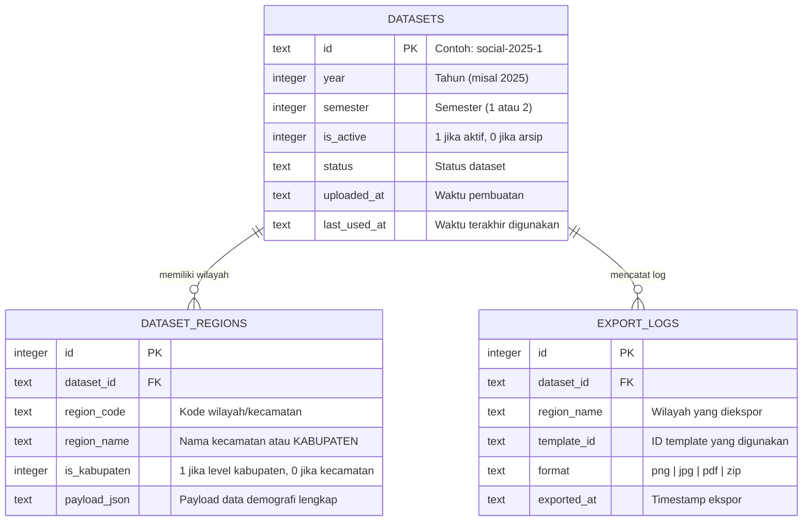

# 📊 Disduk Infografis Generator V2

> **Generator Infografis Kependudukan & Pencatatan Sipil**  
> Dinas Kependudukan dan Pencatatan Sipil (Disdukcapil) Kabupaten Tasikmalaya

Aplikasi web modern berbasis Node.js dan Vanilla JavaScript (ES Modules native) untuk mengelola data agregat kependudukan serta memproduksi infografis beresolusi tinggi (HiDPI) secara instan, dinamis, dan terintegrasi langsung dengan database SQLite lokal.

Mendukung dua kanal visualisasi utama: **Poster Cetak A4** untuk laporan resmi dan **Carousel Instagram (4:5)** untuk publikasi media sosial.

---

[](https://nodejs.org/)
[](https://expressjs.com/)
[](https://github.com/WiseLibs/better-sqlite3)
[](https://pptr.dev/)
[](https://tailwindcss.com/)
[](docs/CHANGELOG.md)

---

## 📑 Daftar Isi

- [🌟 Ringkasan Sistem](#-ringkasan-sistem)
- [🎯 Fitur Utama](#-fitur-utama)
- [🛠️ Arsitektur & Teknologi](#️-arsitektur--teknologi)
- [📁 Struktur Direktori](#-struktur-direktori)
- [📋 Prasyarat](#-prasyarat)
- [🚀 Instalasi & Menjalankan](#-instalasi--menjalankan)
- [📖 Panduan Penggunaan (Workflow Operator)](#-panduan-penggunaan-workflow-operator)
- [⚙️ Konfigurasi](#️-konfigurasi)
- [🗄️ Skema Database](#️-skema-database)
- [🔄 Alur Data (Data Flow)](#-alur-data-data-flow)
- [🧪 Menjalankan Pengujian (Testing)](#-menjalankan-pengujian-testing)
- [🩺 Troubleshooting](#-troubleshooting)
- [📚 Dokumentasi Terkait](#-dokumentasi-terkait)
- [📄 Lisensi & Hak Cipta](#-lisensi--hak-cipta)

---

## 🌟 Ringkasan Sistem

Project ini menggunakan arsitektur **Dual Workspace Mandiri** yang diisolasi satu sama lain, didukung oleh **satu backend export server** terpadu:

| Komponen | **Full Workspace (Infografis Cetak)** | **Social Workspace (Media Sosial)** |
|---|---|---|
| **Tujuan** | Cetak dokumen resmi, poster, banner A4 | Publikasi carousel Instagram (Slide 1 & Slide 2) |
| **Dimensi Output** | Rasio Poster A4 HiDPI | 1080 × 1350 px (Rasio 4:5 Instagram) |
| **Pilihan Template** | Template 1 (Modern), 2 (Classic), 3 (Compact) | Template 1, 2, 3 V2 (Plug-and-Play Registry) |
| **Cakupan Wilayah** | Kabupaten Tasikmalaya & 39 Kecamatan | Kabupaten Tasikmalaya (Semesteran/Tahunan) |
| **Sumber Data** | Dataset SQLite aktif / Preset kependudukan | Database SQLite (`database/app_database.sqlite`) |
| **Format Export** | PNG, JPG, PDF | PNG, JPG, PDF, ZIP (Paket multi-slide via SSE) |

---

## 🎯 Fitur Utama

### 1. Dual Visual Workspace
- **Full Infografis A4**: Pilihan 3 template infografis lengkap dengan filter Kabupaten dan 39 Kecamatan di Tasikmalaya, dilengkapi *Auto-fitter Engine* untuk mencegah overflow teks dan diagram.
- **Social Media Carousel**: Layout 2 slide terkoordinasi (Slide 1: Ringkasan Demografi, Piramida Penduduk, Status Kawin & Agama; Slide 2: Rincian Dokumen Kependudukan KK/KTP/KIA/Akta & Peringkat Top 3 Kecamatan).
- **Tema Emerald Light & Dark**: Penggantian tema antarmuka visual secara mulus tanpa reload halaman.

### 2. Manajemen Dataset & Basis Data SQLite
- **Penyimpanan Lokal Andal**: Menggunakan SQLite dengan mode WAL (*Write-Ahead Logging*) untuk konkurensi tinggi dan performa cepat.
- **Smart Excel/CSV Importer**: Mengimpor data format JUMDUK (Buku Profil Semester) dengan sistem pencocokan nama kolom otomatis (*synonym mapping*).
- **Manual Data Entry Form**: Formulir input data kecamatan dan kabupaten secara langsung dengan perhitungan otomatis (rasio jenis kelamin, persentase kepemilikan dokumen, dan migrasi netto).
- **Sistem Pengamanan Data**: Dilengkapi dialog konfirmasi kustom dan proteksi otorisasi untuk operasi tulis (tambah dataset, ganti aktif, atau hapus).
- **Audit & Export History**: Riwayat export tercatat otomatis di tabel `export_logs`.

### 3. High-Resolution Chromium Export Engine
- **Presisi Piksel**: Menggunakan Puppeteer Chromium headless untuk merender DOM menjadi gambar dan dokumen vektor PDF beresolusi tinggi (bukan canvas snapshot beresolusi rendah).
- **SSE Real-time Progress Streaming**: Pengunduhan paket ZIP carousel multi-slide menyajikan progress bar langsung ke layar pengguna melalui *Server-Sent Events*.
- **Anti-Hang Protection**: Pemuat aset gambar dibekali perlindungan *timeout race condition* sehingga proses export tidak akan menggantung jika ada aset eksternal yang lambat.
- **Queue Protection**: Tombol export terkunci secara otomatis selama render berlangsung untuk mencegah duplicate submission.

---

## 🛠️ Arsitektur & Teknologi

### Frontend
- **Runtime**: Vanilla JavaScript (ES Modules native, tanpa framework berat / bundler)
- **Styling**: [Tailwind CSS](https://tailwindcss.com/) (CDN) + Custom Design System tokens (`style.css`)
- **Visualisasi Grafik**: [Chart.js](https://www.chartjs.org/) untuk visualisasi donat & progress ring
- **Komunikasi**: Fetch API & Server-Sent Events (SSE)

### Backend
- **Framework**: [Express.js](https://expressjs.com/) (Node.js `"type": "module"`)
- **Renderer**: [Puppeteer](https://pptr.dev/) (Chromium headless singleton instance pool via `browser-manager.js`)
- **Database Engine**: [better-sqlite3](https://github.com/WiseLibs/better-sqlite3) (sinkron, zero-latency)
- **Data Processor**: [SheetJS (xlsx)](https://docs.sheetjs.com/) untuk parsing Excel
- **Kompresi Arsip**: [JSZip](https://stuk.github.io/jszip/) untuk bundel export carousel ZIP

---

## 📁 Struktur Direktori

```text
├── database/
│   └── app_database.sqlite          # Database SQLite aktif (mode WAL)
├── data/                            # File referensi baseline semester (JSON)
├── docs/                            # Dokumentasi teknis & arsitektur
│   ├── ARCHITECTURE_V2.md           # Desain arsitektur detail
│   ├── DECISION_LOG.md              # Architecture Decision Records (ADR)
│   ├── PRD_V2.md                    # Product Requirements Document
│   └── CHANGELOG.md                 # Catatan rilis dan versi
├── img/                             # Aset gambar, logo Disdukcapil, dan background
├── server/                          # Backend Express & Puppeteer
│   ├── server.js                    # Server entry point & export routes
│   ├── browser-manager.js           # Puppeteer singleton manager & pre-warm pool
│   ├── data-routes.js               # REST API manajemen data & dataset
│   ├── renderer.js                  # Engine render poster Full Workspace
│   ├── social-renderer.js           # Engine render carousel Social Workspace
│   ├── template-loader.js           # Validator & loader template server-side
│   └── db/
│       ├── connection.js            # Koneksi database SQLite (WAL mode)
│       ├── migrate.js               # Runner migrasi skema database
│       ├── seed.js / seed-full.js   # Script seeder data awal Excel ke SQLite
│       └── repositories/            # Data Access Layer (Dataset, Region, Export Log)
├── src/                             # Frontend JavaScript
│   ├── app.js                       # Controller utama aplikasi
│   ├── charts/                      # Modul pembuat grafik Chart.js
│   ├── engine/                      # Data binding, export engine, template engine
│   ├── excel/                       # Dataset manager, normalizer, dan synonym mapping
│   ├── parsers/                     # Parser PDF dan fallback JSON
│   ├── services/                    # API client HTTP ke endpoint backend
│   └── ui/                          # Sidebar, modal dialog, formulir input data
├── storage/
│   ├── datasets/                    # File sumber Excel (2023, 2024, 2025)
│   ├── exports/                     # Temporary export artifacts
│   └── logs/                        # File log operasional
├── templates/
│   ├── template-1..3/               # Template Full Workspace (Poster A4)
│   └── social/
│       └── template-1..3/           # Template Social Media Carousel (2 Slide)
├── test/                            # Suite pengujian E2E & regresi Puppeteer
├── index.html                       # Entry point antarmuka web
├── package.json                     # Definisi dependensi & skrip Node.js
└── style.css                        # Styling kustom antarmuka
```

---

## 📋 Prasyarat

- **Node.js**: Versi `18.0.0` atau lebih tinggi
- **npm**: Bawaan dari instalasi Node.js
- **Koneksi Internet**: Diperlukan saat pertama kali `npm install` untuk mengunduh binary Chromium yang sesuai dengan sistem operasi Anda.

---

## 🚀 Instalasi & Menjalankan

### 1. Klon Repositori
```bash
git clone https://github.com/G-FaishalIhsan/Disduk-Infografis-Generator-V2.git
cd Disduk-Infografis-Generator-V2
```

### 2. Pasang Dependensi
```bash
npm install
```

### 3. Jalankan Server
```bash
npm start
```

Server akan aktif secara lokal di port `3000`.

### 4. Akses Aplikasi
Buka peramban (browser) dan kunjungi:
```text
http://localhost:3000
```

---

## 📖 Panduan Penggunaan (Workflow Operator)

### A. Navigasi & Memilih Mode
1. Pada sidebar kiri, pilih mode visualisasi:
   - **Full Workspace**: Untuk membuat infografis satu halaman poster A4.
   - **Social Workspace**: Untuk membuat paket postingan carousel Instagram 2 slide (1080x1350px).
2. Pilih nomor template yang diinginkan (Template 1, Template 2, atau Template 3).

### B. Mengelola Dataset Kependudukan
1. Klik tombol **Kelola Dataset** di sidebar.
2. Anda dapat:
   - **Memilih Dataset Aktif**: Pilih semester/tahun yang ingin divisualisasikan, lalu klik **Jadikan Aktif**.
   - **Upload File Excel Baru**: Unggah file `JUMDUK SEMESTER` (.xlsx). Kolom data akan dipetakan secara otomatis.
   - **Entri Data Manual**: Tambahkan data baru secara langsung melalui form entri data berpanduan.

### C. Melakukan Ekspor
1. Pastikan pratinjau (*live preview*) pada layar sudah menampilkan data yang sesuai.
2. Di panel atas atau sidebar:
   - Pilih format ekspor: **PNG**, **JPG**, atau **PDF**.
   - Untuk Social Media, Anda juga dapat mengklik **Export Carousel (ZIP)** untuk mengunduh kedua slide sekaligus dalam satu file terkompresi dengan progress bar real-time.
3. File akan diproses oleh mesin Chromium server dan otomatis diunduh ke peramban Anda.

---

## ⚙️ Konfigurasi

Variabel lingkungan yang dapat dikonfigurasi:

| Variabel | Default | Keterangan |
|---|---|---|
| `PORT` | `3000` | Port HTTP lokal untuk menjalankan Express server |

Menjalankan pada port khusus:
```bash
# Di Linux / macOS
PORT=8080 npm start

# Di Windows (PowerShell)
$env:PORT="8080"; npm start
```

---

## 🗄️ Skema Database

Skema dikelola menggunakan SQLite (`database/app_database.sqlite`) dan termigrasi otomatis pada saat server pertama kali diinisialisasi:



---

## 🔄 Alur Data (Data Flow)

```
[Sumber Data Excel/Input Manual]
               │
               ▼
[SQLite: database/app_database.sqlite]
               │
               ├─────────────────────────┐
               ▼                         ▼
   [GET /api/data/datasets]      [Chromium Puppeteer Export]
               │                         │
               ▼                         ▼
      [Frontend Preview]         [PNG / JPG / PDF / ZIP]
```

1. **Storage Layer**: Data kependudukan tersimpan di SQLite secara terstruktur.
2. **Client Binding**: Frontend mengambil data dataset aktif melalui REST API, melakukan kalkulasi metrik, dan menampilkannya ke dalam live preview.
3. **High-Res Rendering**: Saat tombol export ditekan, template HTML dan payload data dikirimkan ke Chromium headless server untuk di-render sesuai dimensi presisi cetak/sosial.

---

## 🧪 Menjalankan Pengujian (Testing)

Proyek ini dilengkapi suite pengujian end-to-end berbasis Puppeteer di dalam folder `test/`:

```bash
# Menjalankan suite regresi komprehensif
node test/full_regression_suite.mjs

# Pengujian pergantian template & wilayah kecamatan
node test/test-all-template-switching.js

# Pengujian anti-hang pemuat gambar (Image Waiter)
node test/test-image-waiter-fix.js

# Pengujian proteksi antrean ekspor
node test/test-export-queue-blocking.js
```

> **Catatan**: Pastikan server (`npm start`) aktif di background sebelum menjalankan skrip pengujian.

---

## 🩺 Troubleshooting

| Masalah | Kemungkinan Penyebab | Solusi |
|---|---|---|
| **Export macet / loading terus-menerus** | Aset gambar atau logo tidak dapat diakses | Periksa folder `img/` dan pastikan file gambar tersedia. Server telah dilengkapi timeout race condition otomatis. |
| **Data preview berbeda dengan hasil export** | Dataset aktif pada server berbeda dengan cache browser | Lakukan refresh halaman atau pilih ulang dataset aktif di menu Kelola Dataset. |
| **Gagal menjalankan Puppeteer di Linux Server** | Dependensi sistem pustaka Chromium belum terpasang | Pasang dependensi Chromium Linux (misalnya: `libnss3`, `libatk-bridge2.0-0`, `libxss1`). |
| **Port 3000 sudah digunakan** | Ada aplikasi lain yang berjalan di port 3000 | Jalankan server dengan menentukan port alternatif via variabel `PORT`. |

---

## 📚 Dokumentasi Terkait

Untuk pemahaman teknis lebih dalam, silakan merujuk ke dokumen berikut:
- [`docs/PRD_V2.md`](docs/PRD_V2.md) — Spesifikasi kebutuhan produk V2
- [`docs/ARCHITECTURE_V2.md`](docs/ARCHITECTURE_V2.md) — Detail arsitektur pipeline data dan exporter
- [`docs/DECISION_LOG.md`](docs/DECISION_LOG.md) — Architecture Decision Records (ADR)
- [`docs/CHANGELOG.md`](docs/CHANGELOG.md) — Riwayat perubahan dan rilis versi

---

## 📄 Lisensi & Hak Cipta

Dikembangkan khusus untuk kebutuhan internal **Dinas Kependudukan dan Pencatatan Sipil (Disdukcapil) Kabupaten Tasikmalaya**.  
Hak cipta dilindungi undang-undang.
