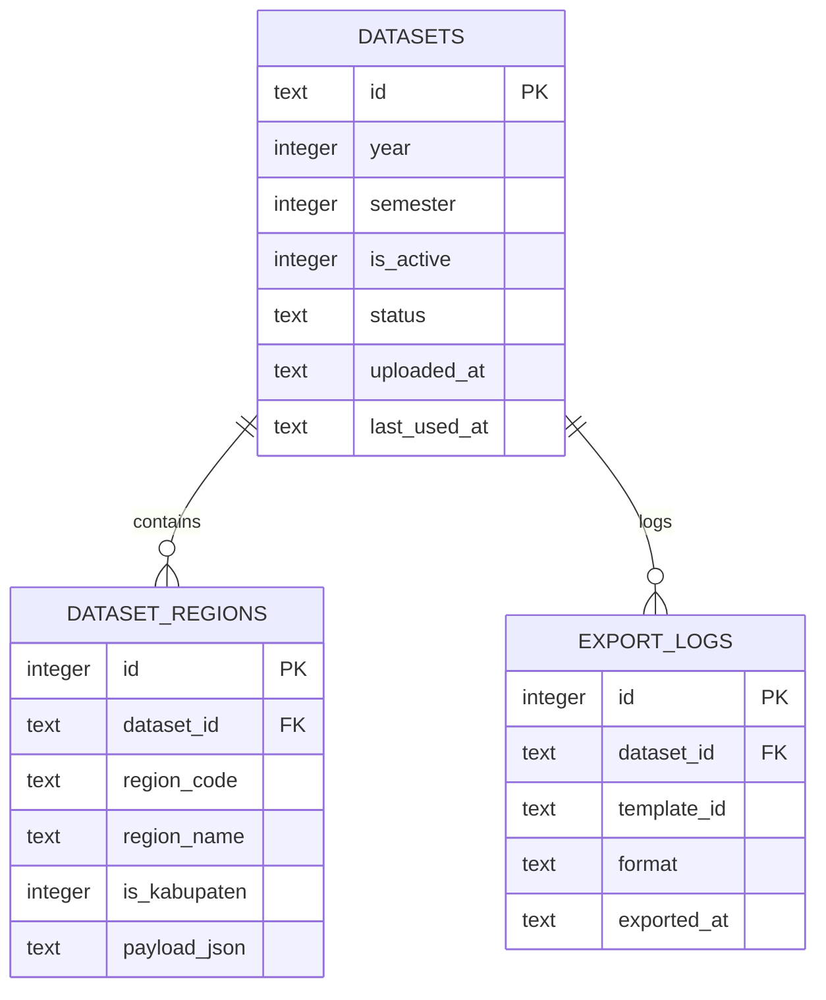

# 📊 Disduk Infografis Generator V2

> **Generator Infografis Kependudukan & Pencatatan Sipil**
> Dinas Kependudukan dan Pencatatan Sipil (Disdukcapil) Kabupaten Tasikmalaya

Aplikasi web berbasis Node.js dan JavaScript murni (ES Modules) untuk mengelola data agregat kependudukan dan mengekspornya menjadi infografis resolusi tinggi (HiDPI) — baik untuk kebutuhan cetak (poster A4) maupun media sosial (carousel Instagram) — secara instan, dinamis, dan berbasis data nyata dari database.

[](https://nodejs.org/)
[](https://expressjs.com/)
[](https://github.com/WiseLibs/better-sqlite3)
[](https://pptr.dev/)

---

## 📑 Daftar Isi

- [Ringkasan](#-ringkasan)
- [Fitur Utama](#-fitur-utama)
- [Arsitektur & Teknologi](#️-arsitektur--teknologi)
- [Struktur Direktori](#-struktur-direktori)
- [Prasyarat](#-prasyarat)
- [Instalasi & Menjalankan](#-instalasi--menjalankan)
- [Konfigurasi (Environment Variables)](#-konfigurasi-environment-variables)
- [Skema Database](#-skema-database)
- [Alur Kerja Data (Data Flow)](#-alur-kerja-data-data-flow)
- [Menjalankan Pengujian](#-menjalankan-pengujian)
- [Troubleshooting](#-troubleshooting)
- [Dokumentasi Tambahan](#-dokumentasi-tambahan)
- [Batasan & Rencana Pengembangan](#-batasan--rencana-pengembangan)
- [Lisensi & Hak Cipta](#-lisensi--hak-cipta)

---

## 🌟 Ringkasan

Project ini punya **dua workspace independen** yang sengaja diisolasi satu sama lain (masing-masing punya sumber data, skema binding, dan template render sendiri), plus **satu backend server** (Express + Puppeteer) yang melayani rendering & export untuk keduanya:

| | **Full Workspace** | **Social Workspace** |
|---|---|---|
| Output | Poster infografis A4 (cetak/web) | Carousel Instagram 2 slide (1080×1350px) |
| Template | Template 1 / 2 / 3 (`templates/template-1..3/`) | Template 1 / 2 / 3 V2 (`templates/social/template-1..3/`) |
| Sumber data | Preset PDF Profil Kependudukan (`src/parsers/pdf-parser.js`) + database SQLite (opsional) | Database SQLite (`database/app_database.sqlite`), input manual/Excel |
| Cakupan wilayah | Kabupaten & 39 Kecamatan | Kabupaten (per periode tahun/semester) |

---

## 🎯 Fitur Utama

### 1. Dual Workspace Mandiri
- **Full Infografis**: 3 pilihan template poster, filter per Kabupaten atau 39 Kecamatan, *Auto-fitter Engine* agar layout tidak overflow, ganti template/kecamatan tanpa reload.
- **Social Media Carousel**: Rasio 4:5 standar Instagram, live preview 2 slide (ringkasan demografi & rincian dokumen kependudukan + Top 3 Kecamatan), tema Emerald Light/Dark.

### 2. Manajemen Dataset & Database SQLite
- Penyimpanan lokal di `database/app_database.sqlite` (mode WAL) — dataset per tahun/semester, satu dataset aktif pada satu waktu.
- Unggah data dari Excel/CSV dengan normalizer otomatis (deteksi sinonim nama kolom, deteksi tahun & semester dari nama/isi file).
- Form input data manual dengan auto-kalkulasi persentase, rasio gender, migrasi netto.
- Dilengkapi sistem otorisasi dan proteksi untuk operasi perubahan dataset.
- Riwayat export tercatat di tabel `export_logs`.

### 3. Engine Export Resolusi Tinggi
- Format: **PNG**, **JPG**, **PDF**, dan **ZIP** (paket carousel multi-slide).
- Render lewat Chromium headless (Puppeteer) — hasil tajam sesuai ukuran cetak/asli, bukan screenshot DOM biasa.
- Progress export real-time via Server-Sent Events (SSE) untuk paket ZIP.
- Anti-hang: pemuat gambar (*image waiter*) dibungkus timeout race, sehingga export tidak macet meskipun ada aset gambar yang lambat/gagal dimuat.
- Anti-duplicate click: tombol export terkunci selama proses berjalan.

---

## 🛠️ Arsitektur & Teknologi

**Frontend** — `index.html`, `src/*` (Vanilla JS ES Modules, tanpa framework/bundler)
- Tailwind CSS (via CDN) + custom CSS tokens (`style.css`)
- Chart.js untuk grafik donat & progress
- Native `fetch` untuk komunikasi ke REST API backend

**Backend** — `server/*` (Node.js + Express, `"type": "module"`)
- Express.js — REST API & static file server
- Puppeteer — render HTML ke PNG/JPG/PDF via Chromium headless, dengan browser instance singleton (`browser-manager.js`) untuk efisiensi
- better-sqlite3 — akses database SQLite secara sinkron
- xlsx (SheetJS) — parsing file Excel/CSV yang diunggah
- jszip / archiver — kompresi paket ZIP carousel

**Data** — `database/`, `storage/`, `data/`
- `database/app_database.sqlite` — dataset kependudukan per tahun/semester
- `storage/datasets/{2023,2024,2025}/` — arsip file Excel sumber per tahun
- `storage/exports/`, `storage/logs/` — hasil export & log

---

## 📁 Struktur Direktori

```text
├── database/
│   └── app_database.sqlite          # Database SQLite aktif (WAL mode)
├── docs/                            # Dokumentasi arsitektur, PRD, ADR, changelog
│   ├── ARCHITECTURE_V2.md
│   ├── DECISION_LOG.md              # Catatan keputusan arsitektural (ADR)
│   ├── PRD_V2.md
│   └── CHANGELOG.md
├── img/                             # Logo, header, dan aset gambar statis
├── data/                            # Data JSON pendukung (mis. baseline semester)
├── storage/
│   ├── datasets/{2023,2024,2025}/   # Arsip file Excel sumber per tahun
│   ├── exports/                     # Output sementara hasil export
│   └── logs/                        # Log aplikasi
├── server/                          # Backend Express + Puppeteer
│   ├── server.js                    # Entry point, endpoint export & health check
│   ├── data-routes.js               # REST API dataset (mount di /api/data)
│   ├── browser-manager.js           # Singleton pool Chromium (Puppeteer)
│   ├── renderer.js                  # Renderer Full Workspace
│   ├── social-renderer.js           # Renderer Social Workspace
│   ├── template-loader.js           # Loader & validasi template ID (server-side)
│   └── db/
│       ├── connection.js            # Koneksi better-sqlite3 (WAL)
│       ├── migrate.js / migrations/ # Skema & migrasi database
│       ├── seed.js / seed-full.js   # Seeder data awal
│       └── repositories/            # Data access layer (dataset, region, export log)
├── src/                             # Frontend (client-side)
│   ├── app.js                       # Orkestrator utama alur aplikasi
│   ├── engine/                      # Binder, template engine, export engine, auto-fitter
│   ├── excel/                       # Reader & normalizer Excel/CSV
│   ├── parsers/                     # Parser preset PDF/JSON kependudukan
│   ├── services/                    # Client HTTP ke REST API dataset
│   ├── charts/                      # Wrapper Chart.js (donut, progress ring)
│   └── ui/                          # Sidebar, modal dialog, form input data, theme controller
├── templates/
│   ├── template-1/ template-2/ template-3/   # Template Full Workspace (poster A4)
│   └── social/
│       └── template-1/ template-2/ template-3/  # Template Social Workspace (carousel)
├── test/                            # ~30 skrip pengujian (Puppeteer-based, end-to-end)
├── index.html                       # Entry point frontend
├── style.css                        # Style global (custom, di luar Tailwind)
└── package.json
```

---

## 📋 Prasyarat

- [Node.js](https://nodejs.org/) **v18 atau lebih baru** (dibutuhkan untuk ES Modules native & kompatibilitas Puppeteer terbaru)
- npm (bawaan Node.js)
- Ruang disk yang cukup untuk Chromium yang diunduh otomatis oleh Puppeteer saat `npm install` (± 200–300MB)

---

## 🚀 Instalasi & Menjalankan

### 1. Klon Repositori
```bash
git clone https://github.com/G-FaishalIhsan/Disduk-Infografis-Generator-V2.git
cd Disduk-Infografis-Generator-V2
```

### 2. Pasang Dependensi
```bash
npm install
```
> Perintah ini juga akan mengunduh binary Chromium untuk Puppeteer. Pastikan koneksi internet stabil pada instalasi pertama.

### 3. Jalankan Server
```bash
npm start
```
Server berjalan di `http://localhost:3000` secara default (lihat [Konfigurasi](#-konfigurasi-environment-variables) untuk mengganti port).

> **Catatan:** `npm run dev` saat ini identik dengan `npm start` (belum menggunakan file-watcher seperti `nodemon`). Untuk auto-reload saat development, jalankan manual dengan `nodemon server/server.js` (perlu `npm install -g nodemon` atau sebagai dev-dependency) atau restart manual setelah setiap perubahan.

### 4. Buka Aplikasi
Akses browser ke:
```
http://localhost:3000
```

---

## ⚙️ Konfigurasi (Environment Variables)

| Variabel | Default | Keterangan |
|---|---|---|
| `PORT` | `3000` | Port HTTP server Express |

Contoh menjalankan di port lain:
```bash
PORT=8080 npm start
```

---

## 🗄️ Skema Database

Skema didefinisikan di `server/db/migrations/001_initial_schema.sql`, dieksekusi otomatis lewat `server/db/migrate.js` saat aplikasi pertama kali dijalankan.



Data access dilakukan lewat repository pattern di `server/db/repositories/` (`datasetRepository.js`, `regionRepository.js`, `fullDatasetRepository.js`, `exportLogRepository.js`) — tidak ada query SQL mentah yang ditulis langsung di route handler.

---

## 🔄 Alur Kerja Data (Data Flow)

**Social Workspace:**
```
SQLite (database/app_database.sqlite)
  → server/db/repositories/*
  → GET /api/data/datasets/*
  → src/services/db-service.js (fetch client)
  → src/excel/datasetManager.js (state + fallback localStorage jika server unreachable)
  → src/engine/dataset-service.js (activeDataset di memori)
  → src/engine/binding.js (hitung rasio, persentase, ranking → isi data-bind di DOM)
  → Preview browser  DAN  server/social-renderer.js (Puppeteer, untuk hasil export)
```

**Full Workspace:**
```
src/parsers/pdf-parser.js (preset) atau SQLite (server/db/repositories/fullDatasetRepository.js)
  → src/engine/data-binder.js (dot-path binding ke DOM + Chart.js)
  → Preview browser  DAN  server/renderer.js (Puppeteer, untuk hasil export)
```

> Preview (browser) dan hasil export (server) **wajib membaca dari sumber dataset aktif yang sama** — ini adalah bagian yang sudah diverifikasi lewat regression test (lihat `test/full_regression_suite.mjs`).

---

## 🧪 Menjalankan Pengujian

Project ini punya suite pengujian end-to-end berbasis Puppeteer (~30 skrip) di folder `test/`. Beberapa yang paling relevan dijalankan rutin:

```bash
# Suite regresi utama (database, binding, viewport, exporter)
node test/full_regression_suite.mjs

# Pergantian template & kecamatan
node test/test-all-template-switching.js

# Antrean export & notifikasi
node test/test-export-queue-blocking.js

# Verifikasi image-waiter (anti-hang saat export)
node test/test-image-waiter-fix.js

# Verifikasi fitur dataset (aktivasi, hapus, deteksi tahun)
node test/test-all-dataset-features.js
node test/test-delete-dataset.js
node test/test-year-detection-and-dedup.js
```

Skrip lain di `test/` mencakup pengujian dialog kustom, sinkronisasi tema, live update social, dan verifikasi tahap implementasi (`verify-phase-a/b/c.js`) — jalankan sesuai kebutuhan area yang sedang diubah.

> Pastikan server (`npm start`) berjalan di background sebelum menjalankan skrip test yang memanggil endpoint export.

---

## 🩺 Troubleshooting

| Gejala | Kemungkinan Penyebab | Solusi |
|---|---|---|
| Export macet / timeout `Runtime.callFunctionOn` | Aset gambar (logo/background) gagal dimuat | Pastikan semua path gambar di `img/` valid; image-waiter sudah dilindungi timeout race, tapi cek console server untuk detail |
| Data di preview beda dengan hasil export | Dataset aktif berbeda antara sesi browser & request export | Pastikan dataset aktif di-set lewat `/api/data/datasets/:id/activate` sebelum export, jangan mengandalkan state browser saja |
| Puppeteer gagal start (`Failed to launch browser`) | Dependensi sistem Chromium belum lengkap (khususnya di Linux server minimal) | Install dependensi sistem Chromium (lihat [dokumentasi Puppeteer](https://pptr.dev/troubleshooting)) |
| Port 3000 sudah dipakai | Ada proses lain di port yang sama | Jalankan dengan `PORT=xxxx npm start` |
| Data lama masih muncul setelah update dataset | Cache browser / state frontend belum refresh | Reload halaman; cek `src/excel/datasetManager.js` untuk logika fallback localStorage |

---

## 📚 Dokumentasi Tambahan

- [`docs/PRD_V2.md`](docs/PRD_V2.md) — Product Requirements Document V2
- [`docs/ARCHITECTURE_V2.md`](docs/ARCHITECTURE_V2.md) — Detail arsitektur pipeline data & export
- [`docs/DECISION_LOG.md`](docs/DECISION_LOG.md) — Architecture Decision Records (ADR)
- [`docs/CHANGELOG.md`](docs/CHANGELOG.md) — Riwayat perubahan versi
- [`PROJECT_KNOWLEDGE_BASE.md`](PROJECT_KNOWLEDGE_BASE.md) — Basis pengetahuan project (konteks tambahan)
- [`SUMMARY_VERSI_1.md`](SUMMARY_VERSI_1.md) — Ringkasan versi 1

> Dokumentasi arsitektur direview secara berkala agar tetap sinkron dengan kode aktual — jika menemukan bagian yang sudah tidak sesuai implementasi, mohon dilaporkan/diperbarui.

---

## ⚠️ Batasan & Rencana Pengembangan

- Pengembangan sistem otentikasi role-based multi-user lanjutan.
- Dukungan auto-reload development dengan file-watcher.
- Penyusunan konfigurasi terpusat berbasis environment variables.
- Full Workspace masih bergantung pada preset statis (`pdf-parser.js`) sebagai sumber utama; integrasi penuh ke SQLite untuk workspace ini bersifat opsional dan dapat diaktifkan lewat `fullDatasetRepository.js`.
- Belum ada CI/CD otomatis untuk menjalankan test suite pada setiap push/PR.

---

## 📄 Lisensi & Hak Cipta

Dikembangkan untuk kebutuhan internal Dinas Kependudukan dan Pencatatan Sipil (Disdukcapil) Kabupaten Tasikmalaya.
Seluruh hak cipta dilindungi. Belum ada file `LICENSE` eksplisit di repositori ini — hubungi pemilik repositori untuk ketentuan penggunaan/distribusi lebih lanjut.
